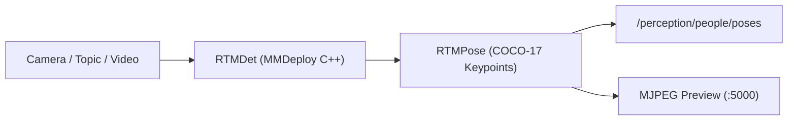

# perc-person_pose

[](https://docs.ros.org/en/humble/) [](LICENSE) [](mailto:teamrobontu@gmail.com)

ROS 2 (Humble) C++ stack for top-down human pose estimation — **RTMDet** (person
detection) + **RTMPose** (keypoints) via the **MMDeploy C++ SDK** — publishing typed
COCO-17 keypoints on `/perception/people/poses`, plus an MJPEG preview on `http://localhost:5000`.
The MMDeploy SDK runs on **TensorRT** (Jetson / NVIDIA dGPU) or **ONNXRuntime-CPU**
(dev box) with the *same* node binary — only the exported model and the `device`
parameter change.


---


## Architecture



## I. Requirements

- **OS / middleware:** Ubuntu 22.04, ROS 2 Humble
- **Build tools / libs:** `build-essential`, `cmake`, `wget`, `libopencv-dev` (4.5.4
  already present), `libspdlog-dev` (the MMDeploy SDK logs through it)
- **Inference SDK:** MMDeploy C++ SDK **1.3.1** + ONNXRuntime **1.15.1** (CPU path), or
  the CUDA 11.8 MMDeploy SDK + TensorRT 8.6.1 / cuDNN 8.9 (GPU path). The ORT version
  **must** match the SDK build — mmdeploy 1.3.1 links `libonnxruntime.so.1.15.1`; the
  wrong ORT (e.g. 1.8.1) loads but **segfaults on first inference**.
- **Model export (Python, in `~/pose-env`):** `mmdeploy==1.3.1`, `mmdeploy-runtime==1.3.1`,
  with `numpy==1.26.4`, `setuptools<81`, `opencv-python==4.10.0.84` pinned back (mmdeploy
  otherwise upgrades numpy to 2.x and breaks torch/cv2/pkg_resources).
- **Hardware (any one):** USB webcam (V4L2), Intel RealSense D455 (or any
  `sensor_msgs/Image` publisher), NVIDIA dGPU (RTX), or a Jetson — or none: a static-image
  fallback needs no hardware.
- **Two ROS 2 packages (build them together):**

| Package | Type | What it is |
|---|---|---|
| [`person_pose`](person_pose/) | `ament_cmake` | the node (`person_pose`): camera/topic capture → RTMDet+RTMPose inference → publish + MJPEG preview |
| [`person_pose_interfaces`](person_pose_interfaces/) | `ament_cmake` (rosidl) | the message definitions: `PersonPoseArray` → `PersonPose` → `Keypoint2D` |

> **Versions** are pinned to MMDeploy **1.3.1** / ONNXRuntime **1.15.1** (the ORT the SDK
> is built against — see II.A2), matching the OpenMMLab 2.x line already in `~/pose-env`
> (mmpose 1.3.x). If a download URL 404s, the version moved — grab the current
> `*-linux-x86_64-cxx11abi.tar.gz` from the
> [MMDeploy releases page](https://github.com/open-mmlab/mmdeploy/releases); the layout is
> stable, only the version string drifts.

---

## II. Setup & Installation

Pick the path matching your hardware — **A** (dev box, CPU), **B** (dev box, NVIDIA dGPU),
or **C** (Jetson). All three build the *same* node; only the SDK, exported model, and
`device` differ. Model export (A4–A6) is shared groundwork the GPU paths reuse.

### A. Dev box / WSL2 — CPU + ONNXRuntime

**A1. System prerequisites**

```bash
sudo apt update
sudo apt install -y build-essential cmake wget libopencv-dev libspdlog-dev
```

**A2. Download the prebuilt MMDeploy C++ SDK + ONNXRuntime**

The **`cxx11abi`** tarball is the CPU / ONNXRuntime build (the `-cuda*` variant is for x86
GPUs — path B). The cxx11 ABI matches ROS Humble's libstdc++.

```bash
cd ~
MMDEPLOY_VER=1.3.1
ORT_VER=1.15.1   # MUST match the SDK build: mmdeploy 1.3.1 links libonnxruntime.so.1.15.1.
                 # Using the wrong ORT (e.g. 1.8.1) loads but SEGFAULTS on first inference.

# MMDeploy SDK (CPU, ORT backend)
wget https://github.com/open-mmlab/mmdeploy/releases/download/v${MMDEPLOY_VER}/mmdeploy-${MMDEPLOY_VER}-linux-x86_64-cxx11abi.tar.gz
tar xf mmdeploy-${MMDEPLOY_VER}-linux-x86_64-cxx11abi.tar.gz

# ONNXRuntime runtime shared libs (the SDK's ORT backend dlopen's these)
wget https://github.com/microsoft/onnxruntime/releases/download/v${ORT_VER}/onnxruntime-linux-x64-${ORT_VER}.tgz
tar xf onnxruntime-linux-x64-${ORT_VER}.tgz
```

> **Check the ORT version the SDK needs** rather than trusting this doc — it is baked into
> the plugin's soname:
> `ldd ~/mmdeploy-1.3.1-linux-x86_64-cxx11abi/lib/libmmdeploy_ort_net.so | grep onnx`
> shows e.g. `libonnxruntime.so.1.15.1`; download that exact ORT release.

**A3. Persist the environment variables**

`colcon` (for `find_package(MMDeploy)`) and the running node (for `dlopen` of
`libmmdeploy.so` + the ORT plugin) both need these, so write them to your shell rc:

```bash
cat >> ~/.zshrc <<'EOF'

# --- MMDeploy SDK (CPU / ORT) ---
export MMDEPLOY_HOME=~/mmdeploy-1.3.1-linux-x86_64-cxx11abi
export ONNXRUNTIME_DIR=~/onnxruntime-linux-x64-1.15.1
export MMDeploy_DIR=$MMDEPLOY_HOME/lib/cmake/MMDeploy
export LD_LIBRARY_PATH=$MMDEPLOY_HOME/lib:$ONNXRUNTIME_DIR/lib:$LD_LIBRARY_PATH
EOF
source ~/.zshrc
```

- `MMDeploy_DIR` → what `find_package(MMDeploy)` in `CMakeLists.txt` resolves.
- `LD_LIBRARY_PATH` → lets the node load the SDK + the ORT backend plugin at runtime.

**A4. Install the Python converter (in your existing venv)**

```bash
source ~/pose-env/bin/activate
pip install -r ~/ros2_ws/src/perc-person_pose/requirements.txt
```

`mmdeploy` drives `tools/deploy.py` (the model converter). `mmdeploy-runtime` is a bonus —
it lets you test the exported model from **Python** before building the C++ node (see A6).

> Why the pins: `numpy>=2` crashes `torch 2.1.0` (compiled against numpy 1.x);
> `setuptools>=81` drops `pkg_resources` (mmengine imports it); `opencv-python>=4.11`
> requires numpy 2. `openxlab` version warnings during install are harmless.

**A5. Export the models**

`MMPoseInferencer('human')` defaults to **RTMDet-m (person)** + **RTMPose-m**. Grab the
deploy configs (mmdeploy repo) and the model configs (mmpose repo), then convert:

```bash
git clone -b v1.3.1 https://github.com/open-mmlab/mmdeploy.git ~/mmdeploy-src  # deploy configs
git clone https://github.com/open-mmlab/mmpose.git ~/mmpose-src                 # model configs
cd ~/mmdeploy-src

# --- RTMDet (person detection) -> ~/models/rtmdet ---
# NOTE: use the *static* deploy config. The _dynamic one produces an ONNX with a
# broken `Where` node (int64/float type mismatch) that onnxruntime refuses to load.
python tools/deploy.py \
  configs/mmdet/detection/detection_onnxruntime_static.py \
  ~/mmpose-src/projects/rtmpose/rtmdet/person/rtmdet_m_640-8xb32_coco-person.py \
  https://download.openmmlab.com/mmpose/v1/projects/rtmposev1/rtmdet_m_8xb32-100e_coco-obj365-person-235e8209.pth \
  demo/resources/human-pose.jpg --work-dir ~/models/rtmdet --device cpu --dump-info

# --- RTMPose (keypoints) -> ~/models/rtmpose ---
python tools/deploy.py \
  configs/mmpose/pose-detection_simcc_onnxruntime_dynamic.py \
  ~/mmpose-src/projects/rtmpose/rtmpose/body_2d_keypoint/rtmpose-m_8xb256-420e_coco-256x192.py \
  https://download.openmmlab.com/mmpose/v1/projects/rtmposev1/rtmpose-m_simcc-aic-coco_pt-aic-coco_420e-256x192-63eb25f7_20230126.pth \
  demo/resources/human-pose.jpg --work-dir ~/models/rtmpose --device cpu --dump-info
```

Each `--work-dir` ends up with `end2end.onnx` + `pipeline.json` + `deploy.json` — that
**directory** (not the file) is what you pass as `det_model_path` / `pose_model_path`.

> A `visualize ... model failed` line at the very end of `deploy.py` is **harmless** — it's
> a bug in mmdet/mmpose's Python preview plotting, not the export. As long as `deploy.json`
> + `pipeline.json` + `end2end.onnx` are written, the model is good (confirm with A6, which
> uses the same runtime as the C++ node).

**A6. Verify the export without C++ (optional, recommended)**

```bash
python - <<'EOF'
import os, cv2
from mmdeploy_runtime import Detector, PoseDetector
img = cv2.imread(os.path.expanduser('~/test_pose.jpg'))
det = Detector(model_path=os.path.expanduser('~/models/rtmdet'), device_name='cpu')
bboxes, labels, _ = det(img)
persons = bboxes[labels == 0][:, :4].tolist()
print('persons detected:', len(persons))
pose = PoseDetector(model_path=os.path.expanduser('~/models/rtmpose'), device_name='cpu')
print('keypoints shape:', pose(img, persons)[0].shape)   # expect ~ (17, 3)
EOF
```

Build & run for this path is in **III. How to Run → CPU**.

### B. Dev box dGPU — TensorRT (RTX / CUDA)

Runs the *same node* on an NVIDIA dGPU (incl. under WSL2) — no rebuild, ~**30× faster**
than CPU (~7 → **~230 FPS** on an RTX 4060, FP16). You do **not** need the full CUDA
toolkit; the CUDA 11 runtime that ships with `torch+cu121` is enough, plus TensorRT +
cuDNN from pip.

```bash
# 1. CUDA build of the MMDeploy SDK (TensorRT + ORT backends)
cd ~
wget https://github.com/open-mmlab/mmdeploy/releases/download/v1.3.1/mmdeploy-1.3.1-linux-x86_64-cxx11abi-cuda11.8.tar.gz
tar xf mmdeploy-1.3.1-linux-x86_64-cxx11abi-cuda11.8.tar.gz

# 2. TensorRT + cuDNN wheels (into pose-env). Check the exact TRT/cuDNN sonames the
#    SDK needs:  ldd ~/mmdeploy-1.3.1-*-cuda11.8/lib/libmmdeploy_trt_net.so | grep -E 'nvinfer|cudnn'
source ~/pose-env/bin/activate
pip install --extra-index-url https://pypi.nvidia.com "tensorrt==8.6.1" "nvidia-cudnn-cu11==8.9.6.50"

# 3. Export the models to FP16 TensorRT ENGINES (built for THIS GPU — not portable)
export LD_LIBRARY_PATH=~/pose-env/lib/python3.10/site-packages/tensorrt_libs:~/pose-env/lib/python3.10/site-packages/nvidia/cudnn/lib:$LD_LIBRARY_PATH
cd ~/mmdeploy-src
python tools/deploy.py \
  configs/mmdet/detection/detection_tensorrt-fp16_static-320x320.py \
  ~/mmpose-src/projects/rtmpose/rtmdet/person/rtmdet_m_640-8xb32_coco-person.py \
  https://download.openmmlab.com/mmpose/v1/projects/rtmposev1/rtmdet_m_8xb32-100e_coco-obj365-person-235e8209.pth \
  demo/resources/human-pose.jpg --work-dir ~/models/rtmdet_trt --device cuda --dump-info
python tools/deploy.py \
  configs/mmpose/pose-detection_simcc_tensorrt-fp16_dynamic-256x192.py \
  ~/mmpose-src/projects/rtmpose/rtmpose/body_2d_keypoint/rtmpose-m_8xb256-420e_coco-256x192.py \
  https://download.openmmlab.com/mmpose/v1/projects/rtmposev1/rtmpose-m_simcc-aic-coco_pt-aic-coco_420e-256x192-63eb25f7_20230126.pth \
  demo/resources/human-pose.jpg --work-dir ~/models/rtmpose_trt --device cuda --dump-info
```

Notes:
- **No node rebuild** to switch CPU↔GPU — the node links `libmmdeploy.so.1` by soname; the
  launch file just puts the CUDA SDK (+ TensorRT/cuDNN) on `LD_LIBRARY_PATH` and points at
  the `_trt` engines. `device:=cpu` flips back to the ORT SDK + `.onnx` dirs.
- `.engine` files are **GPU/TensorRT-version specific** — rebuild them per machine.
- The CUDA SDK is `cuda11.8`; the CUDA 11 runtime libs (`libcudart.so.11`,
  `libcublas.so.11`) are already present via `torch+cu121`. If missing:
  `pip install nvidia-cuda-runtime-cu11 nvidia-cublas-cu11`.

**INT8 quantization (optional — `precision:=int8`)**

FP16 is already ~230 FPS on an RTX 4060, so INT8 buys little on a dGPU; it matters on the
**Jetson** (compute/power limited). INT8 needs **post-training calibration** (a few hundred
representative images) and an accuracy check — pose keypoints can degrade more than detection.

```bash
# calibration images: a folder of ~300 representative frames (COCO val, or your own captures)
cd ~/mmdeploy-src
python tools/deploy.py \
  configs/mmdet/detection/detection_tensorrt-int8_static-320x320.py \
  ~/mmpose-src/projects/rtmpose/rtmdet/person/rtmdet_m_640-8xb32_coco-person.py \
  <rtmdet.pth> demo/resources/human-pose.jpg \
  --work-dir ~/models/rtmdet_trt_int8 --device cuda --dump-info
python tools/deploy.py \
  configs/mmpose/pose-detection_simcc_tensorrt-int8_static-256x192.py \
  ~/mmpose-src/projects/rtmpose/rtmpose/body_2d_keypoint/rtmpose-m_8xb256-420e_coco-256x192.py \
  <rtmpose.pth> demo/resources/human-pose.jpg \
  --work-dir ~/models/rtmpose_trt_int8 --device cuda --dump-info
```

The int8 deploy configs pull calibration data from the model's val dataloader by default,
so you need that dataset available (or edit `calib_dataloader` to point at your image folder).

### C. Jetson — TensorRT (the robot)

No prebuilt ARM SDK exists, so build it from source against JetPack's bundled
CUDA / cuDNN / TensorRT (already on the device — do **not** reinstall them).

```bash
# C1. Build deps
sudo apt update
sudo apt install -y cmake ninja-build build-essential libopencv-dev libspdlog-dev

# C2. ppl.cv (MMDeploy's CUDA image-ops dependency)
git clone https://github.com/openppl-public/ppl.cv.git ~/ppl.cv
cd ~/ppl.cv && ./build.sh cuda

# C3. MMDeploy SDK with the TensorRT backend
git clone -b v1.3.1 --recursive https://github.com/open-mmlab/mmdeploy.git ~/mmdeploy-src
cd ~/mmdeploy-src
cmake -B build -GNinja \
  -DMMDEPLOY_BUILD_SDK=ON -DMMDEPLOY_BUILD_SDK_CXX_API=ON \
  -DMMDEPLOY_TARGET_DEVICES="cuda" -DMMDEPLOY_TARGET_BACKENDS="trt" \
  -DMMDEPLOY_CODEBASES=all \
  -Dpplcv_DIR=~/ppl.cv/cuda-build/install/lib/cmake/ppl.cv \
  -DTENSORRT_DIR=/usr/include/aarch64-linux-gnu \
  -DCUDNN_DIR=/usr/lib/aarch64-linux-gnu
ninja -C build
cmake --install build --prefix ~/mmdeploy-sdk

cat >> ~/.bashrc <<'EOF'

# --- MMDeploy SDK (CUDA / TensorRT) ---
export MMDeploy_DIR=~/mmdeploy-sdk/lib/cmake/MMDeploy
export LD_LIBRARY_PATH=~/mmdeploy-sdk/lib:$LD_LIBRARY_PATH
EOF
source ~/.bashrc
```

**C4. Export the models for TensorRT** — same as A5 but with the **TensorRT** deploy
configs and `--device cuda` (each `--work-dir` then contains an `end2end.engine`):

```
configs/mmdet/detection/detection_tensorrt_static-320x320.py
configs/mmpose/pose-detection_simcc_tensorrt_dynamic-256x192.py
```

⚠️ TensorRT engines are **not portable** across GPUs / JetPack versions — build them **on
the Jetson itself**.

---

## III. How to Run

Build both packages, then launch. The `--cmake-args` are needed on this dev box (see
V. Technical Explanation for why):

```bash
cd ~/ros2_ws
source /opt/ros/humble/setup.zsh    # zsh: .zsh, not .bash. Also exports MMDeploy_DIR (A3)
colcon build --packages-select person_pose_interfaces person_pose \
  --cmake-args \
    -DPYTHON_EXECUTABLE=/usr/bin/python3.10 \
    -DCMAKE_IGNORE_PATH=/usr/local/lib
source install/setup.zsh
```

**CPU (ORT):**

```bash
ros2 launch person_pose person_pose.launch.py \
  device:=cpu use_fallback:=true \
  det_model_path:=$HOME/models/rtmdet pose_model_path:=$HOME/models/rtmpose \
  fallback_image_path:=$HOME/test_pose.jpg
```

**dGPU / Jetson (TensorRT):** the launch file auto-selects the CUDA SDK, TensorRT/cuDNN
libs, and the `_trt` engine dirs from `device:=cuda` (already the default):

```bash
ros2 launch person_pose person_pose.launch.py device:=cuda
# INT8 engines (if built, see II.B): add precision:=int8
```

Then `ros2 topic echo /perception/people/poses` and open `http://localhost:5000`. Confirm GPU use
with `nvidia-smi dmon` (dGPU) or `tegrastats` (Jetson).

> **`ros2 launch` is self-contained**: the launch file injects the MMDeploy + ORT `lib`
> dirs into the node's `LD_LIBRARY_PATH` (via `additional_env`), so it works even in a
> shell that hasn't sourced the A3 exports. Only bare `ros2 run person_pose` still needs
> `LD_LIBRARY_PATH` set manually. Symptom of a missing path: `failed to load
> libmmdeploy_ort_net.so` / `Net backend not found: onnxruntime` then a crash.

### Input sources

The node reads frames from one of three sources (it always falls back to a static image
until the live source delivers a frame):

```bash
# Laptop USB webcam (direct OpenCV/V4L2 capture) — the launch default:
ros2 launch person_pose person_pose.launch.py \
  input_source:=camera camera_index:=0 \
  det_model_path:=$HOME/models/rtmdet pose_model_path:=$HOME/models/rtmpose

# Intel RealSense D455 (or any sensor_msgs/Image publisher) — run the camera driver
# separately (e.g. `ros2 launch realsense2_camera rs_launch.py`), then:
ros2 launch person_pose person_pose.launch.py \
  input_source:=topic image_topic:=/camera/color/image_raw \
  det_model_path:=$HOME/models/rtmdet pose_model_path:=$HOME/models/rtmpose
```

> On **WSL2**, direct USB capture (`input_source:=camera`) needs the webcam attached via
> `usbipd` and usually still hits the UVC `grab()` issue — the node detects this and drops
> to the fallback image. The `topic` source has no such limitation, so on WSL2 prefer a
> camera driver node + `input_source:=topic`.

### Parameters

| Parameter             | Default  | Description                                        |
|-----------------------|----------|----------------------------------------------------|
| `input_source`        | `camera` | `camera` (USB/V4L2) or `topic` (subscribe to an Image topic) |
| `image_topic`         | `/camera/color/image_raw` | Image topic for `input_source:=topic` (e.g. D455) |
| `camera_index`        | `0`      | `/dev/videoN` index (V4L2), for `input_source:=camera` |
| `use_fallback`        | `false`  | Force the static image/video instead of any live source |
| `fallback_image_path` | `""`     | Explicit fallback path (else scans `~/test_*`)      |
| `target_fps`          | `5.0`    | Timer rate (node default `5.0`; **launch** default `30.0`) |
| `det_model_path`      | `""`     | **Required.** RTMDet MMDeploy work-dir              |
| `pose_model_path`     | `""`     | **Required.** RTMPose MMDeploy work-dir             |
| `device`              | `cpu`    | `cpu` or `cuda` (node default `cpu`; **launch** default `cuda`) |
| `det_score_thr`       | `0.5`    | Min person-detection confidence (node default `0.5`; **launch** default `0.3`) |
| `frame_id`            | `camera` | `frame_id` stamped on the published message header  |

**Launch-only args** (handled by `person_pose.launch.py`, not node params):

| Arg | Default | Description |
|-----|---------|-------------|
| `device` | `cuda` | picks SDK + libs + default model dir (`cuda`→`*_trt`, `cpu`→`.onnx`) |
| `precision` | `fp16` | TensorRT engine when `device:=cuda`: `fp16` (`*_trt`) or `int8` (`*_trt_int8`). Selects a prebuilt engine — does **not** re-quantize at runtime. |

You can also run the node directly with `ros2 run person_pose person_pose
--ros-args -p <name>:=<value> ...` instead of the launch file.

---

## IV. Repository Structure

```
perc-person_pose/           ← this repo (Team-Robo/public-perc-person_pose)
├── person_pose/        ← node package
│   ├── src/{person_pose.cpp, mjpeg_server.hpp}
│   ├── launch/person_pose.launch.py
│   ├── CMakeLists.txt · package.xml
└── person_pose_interfaces/       ← message package
    ├── msg/{Keypoint2D, PersonPose, PersonPoseArray}.msg
    └── CMakeLists.txt · package.xml
```

---

## V. Technical Explanation

**Why C++ / why a new repo.** The original `person_pose_python` (ament_python) node stays in
the tree as a reference. MMPose's `MMPoseInferencer('human')` has no C++ equivalent, so
inference was re-built on the MMDeploy SDK; everything else (camera, MJPEG, keypoint schema)
is a 1:1 port. The node needs a typed message, so `person_pose_interfaces` ships alongside it.

**One binary, three backends.** The node links `libmmdeploy.so.1` **by soname**, and both
the CPU (ORT) and CUDA (TensorRT) SDKs share ABI v1.3.1 — so switching CPU↔GPU is purely a
runtime concern: `LD_LIBRARY_PATH` order picks the SDK, and the model dir picks `.onnx`
(ORT) vs `.engine` (TRT). No rebuild. The launch file resolves this automatically from the
`device` arg and injects the right lib dirs via `additional_env`.

**Why the extra `--cmake-args`.** This machine has a source-built CPython in `/usr/local`
shipping only a static, non-PIC `libpython3.10.a`. ROS's `rosidl_generator_py` (building
the message Python bindings) otherwise links that and fails with *"recompile with -fPIC"*.
`-DCMAKE_IGNORE_PATH=/usr/local/lib` makes `find_library` skip it and use the apt shared
`libpython3.10.so` instead.

**Output** — `/perception/people/poses` (`person_pose_interfaces/msg/PersonPoseArray`), one
`PersonPose` entry per detected person:

```
PersonPoseArray
  std_msgs/Header   header        # stamp + frame_id of the source frame
  PersonPose[] people
    float64[4]   bbox             # person box [x1, y1, x2, y2]
    float64      bbox_score
    Keypoint2D[] keypoints        # COCO-17 order
      float64 x
      float64 y
      float64 score
```

Inspect it live with `ros2 topic echo /perception/people/poses`.

---

## VI. References

- MMDeploy: https://github.com/open-mmlab/mmdeploy (releases:
  https://github.com/open-mmlab/mmdeploy/releases)
- MMPose (RTMDet / RTMPose configs + weights): https://github.com/open-mmlab/mmpose
- ONNXRuntime releases: https://github.com/microsoft/onnxruntime/releases
- TensorRT: https://developer.nvidia.com/tensorrt · ppl.cv: https://github.com/openppl-public/ppl.cv

## VII. Performance (measured, 2026-09-04)

**Hardware:** 13th Gen Intel Core i9-13900HX (16 cores / 32 threads), NVIDIA
RTX 4060 Laptop GPU (8GB VRAM, driver 592.82), 15GB RAM visible under WSL2.

Spot-checked via each perception node's own throttled `Inference FPS` log
(read live off `/rosout`, not the topic's own message rate - that's capped
at each node's configured tick rate regardless of real throughput) with
the **whole perception stack running simultaneously** (all four nodes
below contending for the same CPU/GPU) - not an isolated microbenchmark.

| Node | Device | Observed Inference FPS |
|---|---|---|
| **person_pose (RTMDet+RTMPose)** | **GPU (TensorRT FP16)** | **~95-105** |
| person_body (StrongSort) | GPU | ~38-74 |
| person_face (InsightFace) | GPU | ~17-21 |
| person_identity (IoU matching) | CPU | ~1300-1900 |

This node was the CPU-only bottleneck of the whole stack before its GPU
(TensorRT) migration (~549% CPU, i.e. ~5.5 cores, at only 10Hz target_fps).

---

## Contributors

- **Khiem Nguyen** (`@KhiemGOM`)

Maintained by **Nanyang Technological University Team Robo** (`teamrobontu@gmail.com`).
## License

Apache-2.0 — see [LICENSE](LICENSE).
